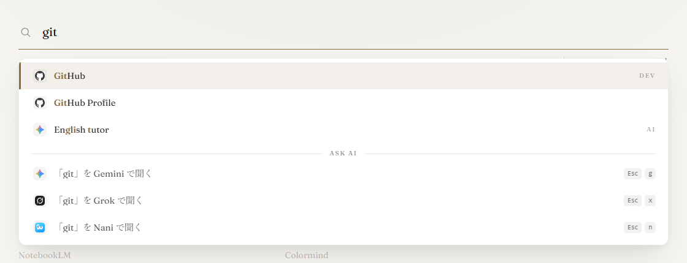

# Start Page

[English README](README.md)

個人用のブラウザのスタートページ。<https://sp.ycookiey.com>で公開している。

<picture>
  <source media="(prefers-color-scheme: dark)" srcset="docs/screenshot-dark.png">
  
</picture>

## ライセンス

このリポジトリのファイルのライセンスは[MIT License](LICENSE)。同梱している次のファイルは、それぞれのライセンスに従う:

- `yfuzzy.min.js`: [yfuzzy](https://github.com/ycookiey/yfuzzy)、MIT。MITライセンスのwanakanaと、BSD-3-ClauseライセンスのMozcのローマ字の表を含む
- `fonts/fraunces-latin.woff2`: フォントのFraunces、[SIL Open Font License 1.1](https://openfontlicense.org/)

`favicons/`はリンク先のサイトのロゴで、権利は各サイトの権利者に帰属する。
